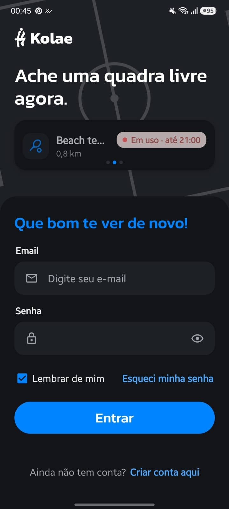
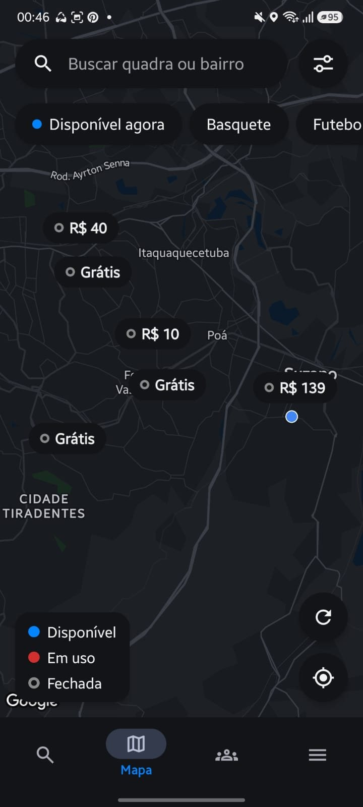

# Kolae Mobile 📱

[](https://github.com/Thesatiru/kolae-mobile/releases/latest)


[](LICENSE)

O app do **Kolae** para quem joga: encontre **quadras esportivas particulares** perto de você,
veja **na hora** se cada uma está livre, em uso ou fechada, confira a agenda do dia e combine o
aluguel com o dono, pelo WhatsApp ou pelo chat do próprio Kolae.

Projeto Integrador da FATEC Ferraz de Vasconcelos. Este repositório é o **app mobile** (React
Native + Expo); o **site e a API** ficam em [`Slengm4n/Kolae`](https://github.com/Slengm4n/Kolae),
e o app consome a API da produção.

🔗 **[Conheça o Kolae](https://kolae.online)** · 📦 **Baixar o APK:** em breve, na página de
download do Kolae (Android).

| Entrada | Pesquisar | Mapa |
| :---: | :---: | :---: |
|  |  |  |

| Quadra | Agenda do dia | Chat com o dono |
| :---: | :---: | :---: |
|  |  |  |

---

## 🆕 Novidades da v1.0 (versão de entrega)

* **Status ao vivo:** cada quadra aparece como Disponível, Em uso ou Fechada, com o horário em que
  muda, e o app atualiza sozinho.
* **Pesquisar:** "N quadras livres agora", destaque da quadra livre mais perto, filtros rápidos,
  buscas recentes, ordem e "Ver no mapa".
* **Chat com o dono** pelo próprio Kolae, que responde pelo painel do site.
* **Telas de entrada novas**, com cadastro em duas etapas e a data de nascimento em roleta.
* **Acessível de verdade:** 8 cores com modo claro e escuro, alto contraste, texto grande, fonte
  para leitura fácil, leitor de tela e 7 idiomas.

Histórico completo no [CHANGELOG](CHANGELOG.md).

---

## ✨ Funcionalidades

### 🔎 Encontrar quadras
* **Pesquisar** com o resumo de quadras livres agora, filtros (livre agora, grátis, coberta,
  iluminação, área de lazer, esporte), ordem (mais perto, menor preço, nome) e as quadras vistas
  recentemente.
* **Mapa** com um pino por quadra na cor do status, filtros por preço, piso, estrutura e
  distância, e a sua posição.
* **Cards** com o status, a distância e o preço.

### 🏟️ A quadra
* Fotos, esportes, piso, estrutura, preço, descrição, horário de funcionamento e endereço com mapa.
* **Status agora e agenda do dia**, com as faixas livres e ocupadas (sem mostrar quem alugou).
* **Falar com o dono** pelo WhatsApp ou pelo **chat do Kolae**, redes sociais da quadra e
  compartilhar o link da página pública.
* **Favoritos**, salvos no seu celular.

### 👤 Conta
* Cadastro (18 anos ou mais), login com "lembrar de mim", esqueci a senha, perfil com foto,
  alterar a senha, tutorial no primeiro acesso e central de ajuda.

### ♿ Aparência e acessibilidade
* **8 cores** (Kolae, Neutro, Verde, Vermelho, Rosa, Roxo, Orgulho e Alto contraste), cada uma
  com modo claro, escuro ou automático, e contraste AA.
* Tamanho do texto, fonte para leitura fácil (Atkinson Hyperlegible), reduzir animações e
  vibração com opção para desligar.
* Leitor de tela em todo o app e **7 idiomas** (português, inglês, espanhol, italiano, japonês,
  chinês e hindi).

### 🧪 Vitrine
A **Comunidade** (rede social do esporte), avaliações, perfis de outras pessoas e os planos
aparecem com o aviso **"Prévia"**: mostram como o Kolae pode crescer, sem falar com a API.

---

## 🛠️ Tecnologias

* **App:** React Native, **Expo SDK 58**, TypeScript (strict) e Expo Router
* **Dados:** axios + TanStack Query, com a [API v1 do Kolae](https://github.com/Slengm4n/Kolae/blob/main/docs/api.md) (JWT); sessão no `expo-secure-store`
* **Mapa e localização:** `react-native-maps` (Google Maps no Android) e `expo-location`
* **Interface:** `react-native-reanimated` (animações), `expo-haptics` (vibração), `expo-image`, fontes Kanit e Atkinson Hyperlegible
* **Idiomas:** i18next, com os textos do site convertidos e os do app (`src/i18n/`)
* **Build:** EAS Build, distribuído como APK para Android

---

## 🚀 Como rodar

### Pré-requisitos
* Node.js e npm
* O app **Expo Go** no celular (Android), na mesma rede Wi-Fi do computador

### Instalação

1. **Clone e instale:**
```bash
git clone https://github.com/Thesatiru/kolae-mobile.git
cd kolae-mobile
npm install
```

2. **Configuração:** copie `.env.example` para `.env`. O padrão já usa a produção:
```bash
EXPO_PUBLIC_API_URL=https://kolae.online/api/v1
EXPO_PUBLIC_MOCK_AUTH=false     # login, cadastro, esqueci a senha, perfil e senha
EXPO_PUBLIC_MOCK_VENUES=false   # esportes e quadras
EXPO_PUBLIC_MOCK_CHAT=false     # conversas com as quadras
```
Em cada área, `true` usa dados de exemplo no formato do contrato (login de teste:
`teste@kolae.com` / `12345678`). Para testar contra um backend local, use o IP do computador que
roda o PHP (não `localhost`, que no celular é o próprio celular).

3. **Rode e abra no celular** (escaneie o QR code com o Expo Go):
```bash
npx expo start
```
No **Windows**, use o PowerShell (não o WSL), com `npx.cmd expo start --offline`: sem login no
Expo CLI, a pergunta de conta trava o Expo Go. Depois de mudar o `.env`, rode com `-c`.

### Verificação
```bash
npx tsc --noEmit   # tipos
npx expo lint      # lint
```

### Gerar o APK
Pelo EAS, perfil `preview`, com a chave própria do Google Maps para Android. Passo a passo, roteiro
de teste pelo 4G e como lançar uma versão em **[docs/apk.md](docs/apk.md)**.

---

## 📚 Documentação

* **[CLAUDE.md](CLAUDE.md):** regras do projeto, como o app consome a API, estrutura e pendências.
* **[CHANGELOG.md](CHANGELOG.md):** o que mudou em cada versão.
* **[docs/apk.md](docs/apk.md):** gerar, testar e lançar o APK.
* No repositório do site: [contrato da API](https://github.com/Slengm4n/Kolae/blob/main/docs/api.md), [decisões](https://github.com/Slengm4n/Kolae/blob/main/docs/decisoes.md) (D01, D02...) e [modelo de status](https://github.com/Slengm4n/Kolae/blob/main/docs/modelo-status.md).

---

## 🔭 Trabalhos futuros

Ficaram de fora da entrega, para não arriscar a estabilidade perto do prazo:

* **Pedidos de horário, anúncios "Patrocinado" e notificações** no app (a API já existe no site).
* **Entrar com Google** e notificação no celular.
* **Comunidade, avaliações e favoritos de verdade**, na conta, com moderação.
* **Partidas com jogadores**, para completar o time, com o dono aprovando o que entra na agenda.
* **Kolae 2.0 em Laravel**, com o mesmo contrato da API (o app só troca a URL).

---

## 👥 Equipe

| | Papel |
| :---- | :---- |
| **Rafael Lana dos Santos** ([@Thesatiru](https://github.com/Thesatiru)) | App mobile |
| **João Slengman** ([@Slengm4n](https://github.com/Slengm4n)) | Site, API, banco de dados, servidor e deploy; também no app |
| **Prof. Jeferson Roberto de Lima** | Orientador |

Trabalho desenvolvido na **FATEC Ferraz de Vasconcelos**, 2026.

---

## 🤝 Contribuição

* Uma branch por assunto (`feat/...`, `fix/...`, `docs/...`, `release/...`), com PR para a `main`.
* Cada branch anota o que mudou em [`changelog/`](changelog/README.md); ao lançar, as notas viram
  uma seção do [CHANGELOG](CHANGELOG.md).
* Versionamento [SemVer](https://semver.org/lang/pt-BR/) com tags `vX.Y.Z`.

---

## 📄 Licença

**Todos os direitos reservados** a João Slengman e Rafael Lana dos Santos. O código está público
apenas para consulta, avaliação acadêmica e portfólio: copiar, modificar, distribuir ou usar
exige autorização por escrito dos autores. Detalhes em [LICENSE](LICENSE).
